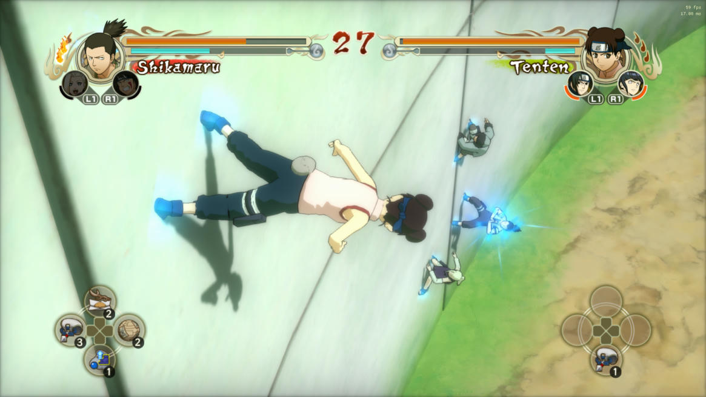
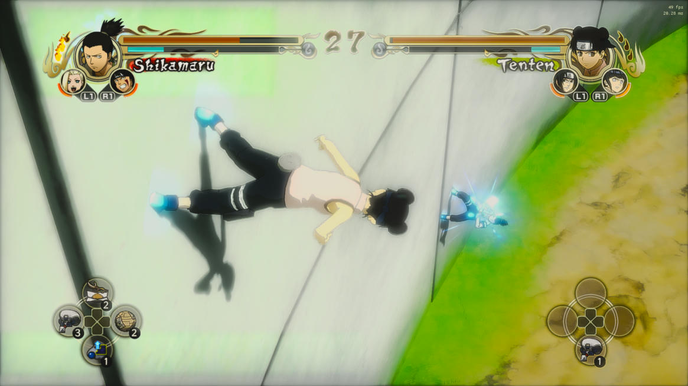
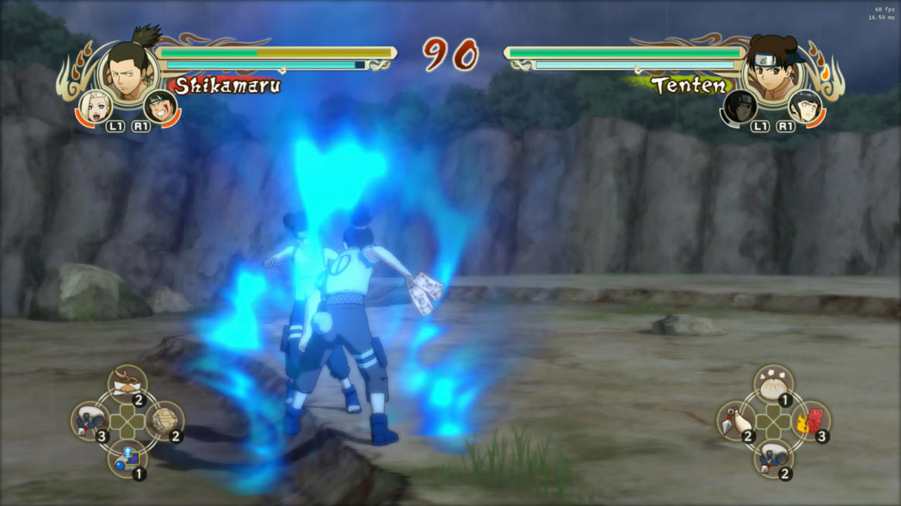
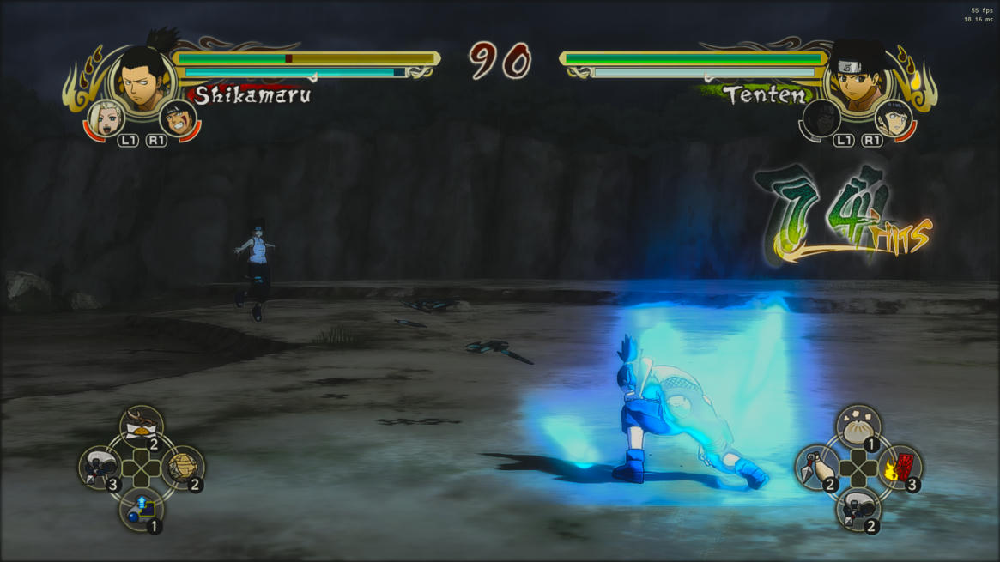
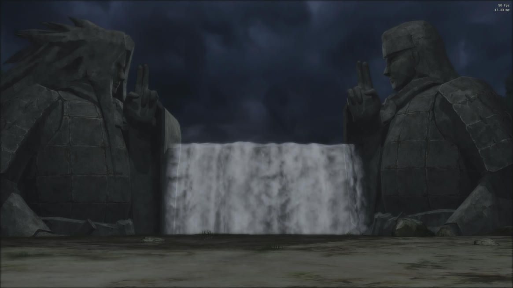
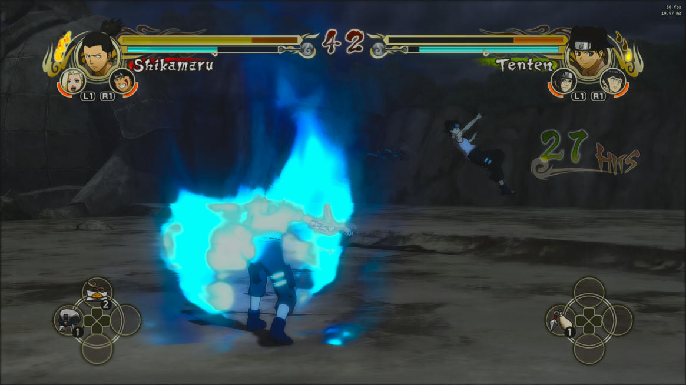
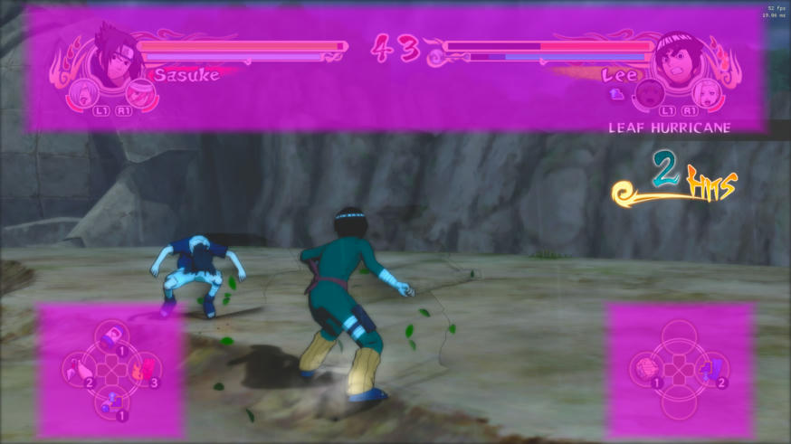
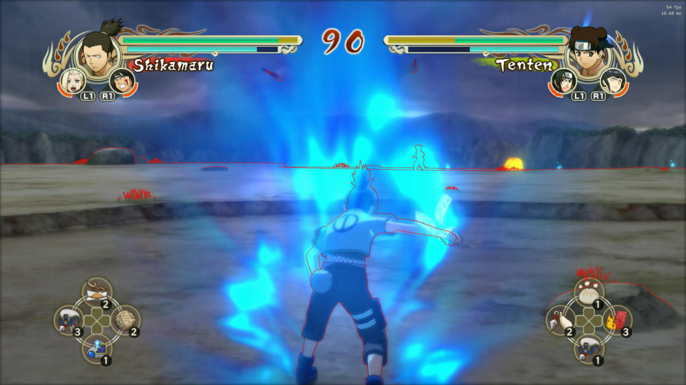

# Naruto Storm Remaster (ReShade)

A UI-aware, moody "modern remaster" look for **NARUTO: Ultimate Ninja STORM** (PC, Steam app 495140), tuned on an **ASUS ROG Ally Z1 Extreme** at 1080p.

Darker, cinematic grading with an adaptive filmic tone curve, super-bright jutsu glow, bloom, lens flares and anamorphic streaks, light shafts, screen-space reflections, two-stage sharpening and depth fog. The health bars, portraits and item wheels stay untouched.

| Effects off | Naruto Storm Remaster (High) |
|---|---|
|  |  |
|  |  |




*Screenshots were captured on the ROG Ally at 1920×1080 during development. Pairs were taken a fraction of a second apart by toggling ReShade, so the animation frames differ slightly.*

## Features

All effects are original shader code in one file, [`NS_Remaster.fx`](reshade-shaders/Shaders/NS_Remaster.fx).

| Effect | What it does |
|---|---|
| **Adaptive filmic tone mapping** | ACES-style toe and shoulder applied to brightness only, so colours keep their vibrancy. Auto-exposure eases toward a balanced level (±0.4 EV), and adaptive vibrance boosts dull scenes. Deep, moody base exposure. |
| **Colour grade** | Filmic contrast, highlight roll-off, warm highlights with neutral shadows, and saturation and vibrance with **skin-tone** and **teal-clothing** protection. Vignette. |
| **Jutsu / FX glow** | Near-clipped, strongly coloured pixels (chakra, fire, lightning, Rasengan) feed an extra-strong bloom and are exempt from the darker grade, so they shine. |
| **Bloom** | 6-level HUD-masked bloom. The glow spills into darker surroundings instead of blowing out bright walls. |
| **Lens flare + anamorphic streaks** | Chromatic ghost reflections and a halo ring from bright hotspots only, plus short horizontal streaks. |
| **Light shafts** | Radial god rays from bright sky or distant haze. They switch off automatically under overcast skies. |
| **Screen-space reflections** | On floors and other upward-facing surfaces, with grass rejection and Fresnel. The surface reads as "wet" rather than mirrored. |
| **Sharpening** | Contrast-adaptive one-pixel sharpening clamped to neighbouring pixel values (no halos on cel outlines), plus a wider detail boost. |
| **Fog** | Distance-only, starting where this game's arenas end, with its colour matched to the sky and glowing toward the sun side. |
| **Rim light** | Anime-style edge glow on characters standing in front of a bright background. |
| **Simulated RTGI (Ultra only)** | GTAO ambient occlusion plus one-bounce screen-space colour bleeding. *This is a screen-space approximation, not hardware ray tracing.* |
| **Anti-aliasing (Ultra only)** | Luma edge search plus directional resample. |
| **Manga look (Manga preset)** | Depth/normal ink lines with reduced lines on grass, and soft cel tone bands on scenery. |

## Install

This is a regular ReShade preset; there's no installer of its own.

1. Download `NarutoStormRemaster-<version>.zip` from [Releases](../../releases). Extract it **into the game folder**, the one containing `NSUNS1.exe` (Steam → right-click the game → Manage → Browse local files). That adds `reshade-shaders\Shaders\NS_Remaster.fx` and the `NarutoStorm_*.ini` presets. No game files are replaced.
2. Run the ReShade setup from **https://reshade.me** (tested with 6.7.3):
   - Select `NSUNS1.exe` and choose **DirectX 10/11/12**.
   - At **Select preset to install**, browse to `NarutoStorm_High.ini` in the game folder.
   - On the effect packages page, **uncheck everything**: the preset only needs `NS_Remaster.fx`, which you already extracted.
3. Start the game and press **Home** to open ReShade. If the tutorial shows, skip it.
4. **One-time depth setting:** Home → **Add-ons** → **Generic Depth** → tick **Copy depth buffer before clear operations**. All tuning and testing was done with this on.

Already have ReShade on this game? Extract the zip, then pick `NarutoStorm_High.ini` from the preset dropdown at the top of the ReShade menu. Switch presets the same way.

## Presets

All presets keep the same look. Lower presets only drop the more expensive effects.

| Preset | Effects | GPU cost @1080p, Z1 Extreme |
|---|---|---|
| Vanilla | none | 0 ms |
| Low | grade, fog, bloom, jutsu glow, flares, sharpening | ~5.4 ms *(estimated from per-effect timings)* |
| Medium | Low + light shafts | ~6.3 ms *(estimated)* |
| **High** (default) | Medium + reflections | **7.1 ms measured** (before flares/streaks were added; those add ~0.3 ms estimated) |
| Ultra | High + simulated RTGI/AO (half-res) + AA | ~10 ms *(estimated)* |
| Manga | High + ink lines + cel tone bands | ~7.6 ms *(estimated)* |

## Performance (measured)

Device: ASUS ROG Ally **Z1 Extreme** (Radeon 780M), Windows 11, game at **1920×1080 fullscreen**, in-game MSAA on, FXAA on, shadows 1, motion blur on, glare on, streamed over Parsec. Timings come from ReShade's Statistics tab during real battles.

| Scene | Preset | Post-processing GPU time | FPS |
|---|---|---|---|
| Any, effects off | — | — | 60 (the game's frame cap) |
| Valley of the End arena (rain) | High (final) | 7.1 ms | 50–58 |
| Forest arena, heavy chakra effects | High + flares | n/a | 46–49 |
| Forest arena, all effects incl. half-res AO | ≈Ultra (earlier build) | 9.0 ms | 42–46 |

Per-effect GPU cost (High, final build): Begin 1.28 ms, Reflections 1.05 ms, Light shafts 0.93 ms, Bloom 1.34 ms (+flares), Sharpen 0.72 ms, Finish 1.80 ms.

**The game is capped at 60 FPS**, so the original 70 FPS target is impossible for any mod. The mod targets 40+ FPS minimum. High stayed above that in every battle tested; Ultra is close to it in the heaviest scenes. If you want more headroom, use Medium or Low.

## How the HUD is protected

The HUD is drawn after the 3D scene, but ReShade only sees the final frame. Measurements from this game drove three layers of protection:

1. **Depth-tagged HUD heads.** The fighter portraits are 3D heads drawn at linear depth < 0.001 (the nearest real scenery is > 0.03), so those pixels are restored exactly.
2. **HUD boxes.** The battle HUD (both health blocks and both item wheels) and the free-roam HUD (portrait and button help) were measured in-game. A box activates only while its HUD is detected: battle mode is recognised by the opponent's portrait in the top-right. Inside a box only per-pixel grading applies. No bloom, sharpening, reflections, AO or flares are drawn there, and no bloom is generated from it.
3. **Menus and videos.** Full-screen menus and pre-rendered videos have no 3D depth, so they're shown untouched.



## Depth sync fix ("ghost doubles")

This game shows each image one frame after its depth buffer. Without correction, every depth effect trails moving characters, producing ghost outlines. The shader keeps the previous frame's depth (**Depth → Delay depth by one frame**, on by default), together with ReShade's **Copy depth buffer before clear operations** (install step 4). The red edges in the debug view below sit exactly on the characters:



## Known limitations

- **Text and prompts outside the HUD boxes** (combo counter, move names, Ninjutsu-clash prompts, the battle results screen) still get grading and glow.
- **Pause and results screens drawn over the 3D scene** still have depth, so they get effects. Only depth-less menus are bypassed.
- **Screen-space effects can't see off-screen objects.** Reflections fade at screen edges, and the simulated GI only bounces visible colour.
- **On camera cuts**, one frame can show depth effects from the previous shot, because of the one-frame depth delay.
- **Not yet tested:** free-roam dialogue boxes, story-mode menus, the map and inventory screens, and other resolutions or aspect ratios. The HUD boxes are fractions of the screen measured at 16:9.
- **In-game FXAA** is applied before the HUD by the game. The Ultra preset adds its own AA, so turn the game's FXAA off in its launcher settings when using Ultra.

## Troubleshooting

| Problem | Fix |
|---|---|
| Nothing changes in game | Check effects aren't toggled off (ReShade's effect toggle key, set under Home → Settings). Make sure ReShade was installed for `NSUNS1.exe` with DirectX 10/11/12, and that `NS_Remaster.fx` is in `reshade-shaders\Shaders`. |
| "failed to compile" in the ReShade menu | Hover the red entry for the message and open an issue with it. Make sure ReShade is 5.0 or newer. |
| Outlines/AO trail behind characters | **Home → NS_Remaster.fx → Depth → Delay depth by one frame** must be on. |
| Too dark / too bright | **Colour grade → Exposure** (default −0.9) and **Adaptive exposure**. |
| HUD looks affected | **Debug view → HUD mask** shows protected areas in magenta. Add an extra box in **HUD / Menus → Extra protected box**. |
| Low FPS | Pick `NarutoStorm_Medium.ini` or `NarutoStorm_Low.ini` from the preset dropdown. |

## Uninstall

- **Remove the preset only:** delete `reshade-shaders\Shaders\NS_Remaster.fx` and the `NarutoStorm_*.ini` files from the game folder.
- **Remove ReShade too:** run the ReShade setup again, pick the game, and choose **Uninstall**.

## Building / development

```bash
python tools/check_presets.py
```
```bash
powershell -ExecutionPolicy Bypass -File tools/build_release.ps1 -Version 1.1.0
```

- `check_presets.py` checks that every preset only uses techniques and settings that exist in the shader.
- `build_release.ps1` writes `dist/NarutoStormRemaster-1.1.0.zip` with the same layout as this repo's root. ReShade binaries are never included.

The repo root mirrors a game folder. The shader only compiles inside ReShade, so for live iteration keep the game running, edit `reshade-shaders\Shaders\NS_Remaster.fx` in the game folder, and press **Reload** in the ReShade menu.

## License

MIT for everything in this repository (see [LICENSE](LICENSE)). ReShade is © crosire and is downloaded separately. NARUTO © Masashi Kishimoto/Shueisha. The game is © BANDAI NAMCO/CyberConnect2, and screenshots are included for illustration only.
